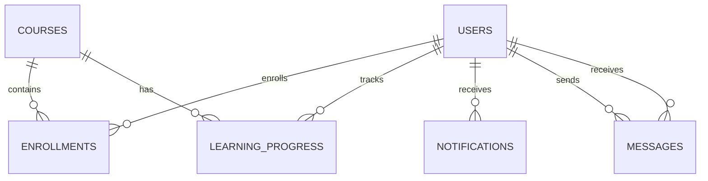

## Database Schema — Student Course Management System

## Database
- Database: MongoDB
- ODM: Mongoose
- Identifiers: MongoDB-generated ObjectId (`_id`)
- Timestamps: `createdAt` and `updatedAt` on all collections

## Collections

### 1. Users
- `_id`: ObjectId — Primary identifier
- `name`: String — Required, trimmed
- `email`: String — Required, unique, lowercase, trimmed
- `passwordHash`: String — Required
- `department`: String — Required, trimmed
- `role`: String — Required; `student` or `admin`; defaults to `student`

### 2. Courses
- `_id`: ObjectId — Primary identifier
- `title`: String — Required, trimmed
- `description`: String — Required, trimmed
- `duration`: String — Required, trimmed

### 3. Enrollments
- `_id`: ObjectId — Primary identifier
- `student`: ObjectId — Required reference to Users
- `course`: ObjectId — Required reference to Courses
- `status`: String — `active`, `completed`, or `withdrawn`; defaults to `active`
- `enrolledAt`: Date — Defaults to current date
- Unique index: `{ student: 1, course: 1 }`

### 4. LearningProgress
- `_id`: ObjectId — Primary identifier
- `student`: ObjectId — Required reference to Users
- `course`: ObjectId — Required reference to Courses
- `completedLessons`: Number — Defaults to 0; minimum 0
- `totalLessons`: Number — Required; minimum 0
- `progressPercentage`: Number — Defaults to 0; range 0–100
- Unique index: `{ student: 1, course: 1 }`

### 5. Notifications
- `_id`: ObjectId — Primary identifier
- `recipient`: ObjectId — Required reference to Users
- `message`: String — Required, trimmed, maximum 500 characters
- `isRead`: Boolean — Defaults to false
- Index: `{ recipient: 1, createdAt: -1 }`

### 6. Messages
- `_id`: ObjectId — Primary identifier
- `sender`: ObjectId — Required reference to Users
- `recipient`: ObjectId — Required reference to Users
- `text`: String — Required, trimmed, maximum 2000 characters
- Index: `{ sender: 1, recipient: 1, createdAt: -1 }`

## Relationship Diagram

